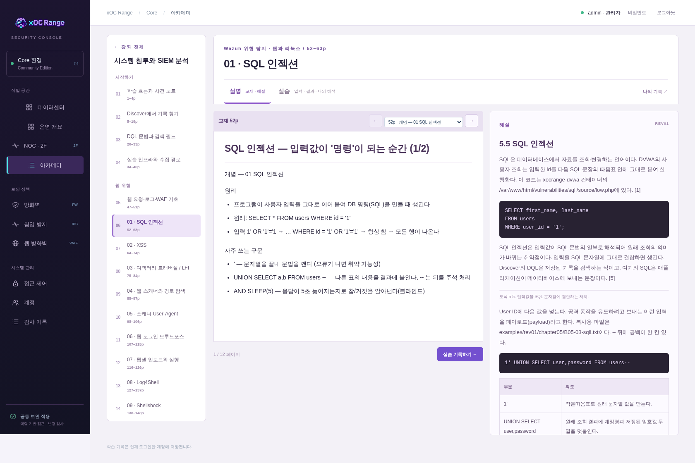
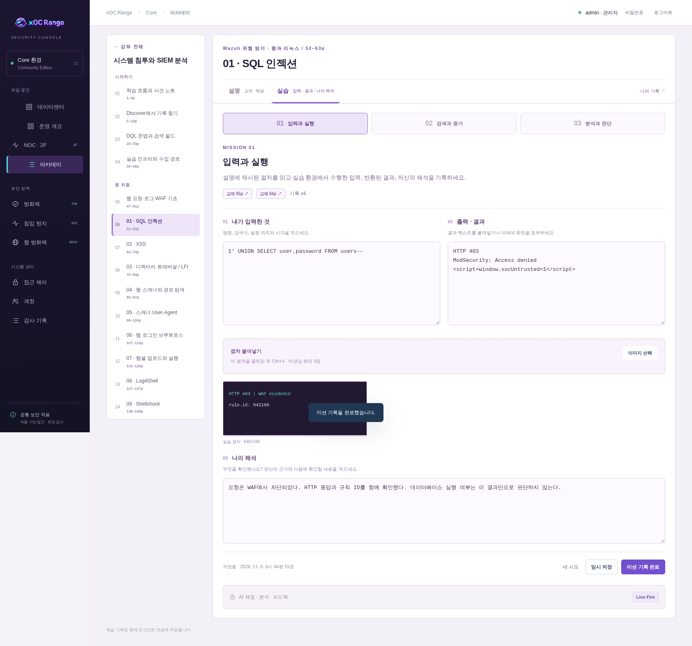

# 아카데미 번들과 개인 실습 기록

Core 로그인 후 왼쪽 **아카데미**를 열거나 `/core/#academy`로 이동한다. 강좌 → 차시 → **설명 / 실습** 순서로 사용한다. 관리자용 6F 상용 공간 미리보기에도 실제 Core 번들 링크를 제공한다. 기존 Core 가이드와 상용 층의 권한 경계는 유지한다.

## 화면

| 화면 | 구성 |
|---|---|
| 카탈로그 | 강좌 표지, 공개 페이지·차시·미션 수, 내 진행률, Core 운영 가이드 |
| 강좌 | 시작하기·웹 위협·리눅스 위협별 36개 차시 |
| 설명 | 왼쪽 차시 목록, 페이지별 교재, 대응하는 REV01 해설, 확대 가능한 캡처 |
| 실습 | 미션 지시문·교재 링크, 입력, 출력 텍스트·캡처, 나의 해석, 임시 저장·기록 완료 |
| 나의 기록 | 내 시도 목록, 저장 내용, 캡처, 수정 이력, JSON 내보내기 |

교재는 전체 외부 PPT를 임베드하지 않고 승인된 1–339쪽의 텍스트·표·이미지를 웹으로 배치했다. 설명 화면의 단독 글머리표를 목록으로 묶고 반복 머리글을 줄였다. 자료 내용과 실제 환경의 정합성 검토는 아직 수행하지 않았다. 원본의 검증 문구는 `원본 교재 검증 기록`으로 표시하며 xOC Range에서 재검증했다는 의미로 바꾸지 않는다.

## 출처와 변경

- 교재: [소유자 제공 PPT](https://docs.google.com/presentation/d/1os-JBFoYF857D_eTOJJw37eFkRlo4kXf/edit), 공개 승인 범위 1–339쪽.
- 해설: [hack_ir_with_wazuh_book_1 / manuscript / REV01](https://github.com/mrgrit/hack_ir_with_wazuh_book_1/tree/main/manuscript/REV01), 차시별로 명시한 절과 연결 이미지.
- 구성 참고: [tw2 / contents](https://github.com/mrgrit/tw2/tree/main/contents). 실행 코드는 복사하지 않았다.
- 원본 파일 해시, 원고 커밋, 페이지·절 매핑은 `contents/academy/wazuh-threat-hunting/source-map.json`에 있다.

PPT 340쪽 이후, 전체 원본, 발표자 노트, 매핑하지 않은 원고·이미지는 포함하지 않는다. 공개 페이지 경계와 명시적 파일 목록은 설치 전 검사한다. 캡처의 KT66 표시·IP·검색 결과는 원본 그대로이며 후속 교재 검토 대상이다.

## 저장과 접근

`platform-data/control.sqlite3`에 다음 세 테이블을 추가했다. 기존 계정·장비 정책·감사 기록은 그대로 사용한다.

- `MissionRecord`: 사용자, 강좌·차시·미션 ID, 콘텐츠 버전, 입력·출력·해석, 상태, 수정 번호.
- `MissionRevision`: 저장할 때마다 텍스트·상태·첨부 ID 목록의 스냅샷. 이전 번호는 변경하지 않는다.
- `MissionEvidence`: 정규화한 WebP 이미지 바이트, 크기·해시·캡션. 이미지도 DB 안에 저장한다.

읽기·쓰기·캡처 조회는 모두 로그인한 본인에게 한정한다. 관리자도 다른 계정의 개인 기록을 이 API로 조회할 수 없다. 조회자 역할도 자신의 실습 기록을 작성한다. 각 저장은 CSRF·Origin, 수정 번호 충돌 검사, 원자적 감사 기록을 적용한다. 계정 전환 시 브라우저 임시 상태를 지운다. 입력한 명령과 결과 텍스트는 실행하지 않고 이스케이프하여 표시한다.

`기록 완료`는 필수 입력이 채워졌다는 뜻이다. 정답 판정이나 실제 실습 성공을 의미하지 않는다. 입력과 해석, 출력 텍스트 또는 이미지가 있어야 완료할 수 있다. AI 채점·분석·피드백은 Live Fire부터 연결하며 Core API에서 실행하지 않는다.

| 항목 | 제한 |
|---|---|
| 입력·출력·해석 | 필드당 UTF-8 24,000바이트 |
| 개인 기록 | 2,000건, 기록당 수정 200회, 전체 수정 텍스트 64 MiB |
| 캡처 | 기록당 3장, 개인 이미지 합계 128 MiB |
| 업로드 | PNG/JPEG/WebP, API 입력 512 KiB, 8백만 픽셀·한 변 6,000 이하 |
| 저장 이미지 | 최대 2,400px로 축소한 WebP, 메타데이터 제외, 건당 최대 1 MiB |

브라우저는 파일 선택과 클립보드 이미지 붙여넣기를 지원하며 전송 전에 줄인다. SVG·손상 이미지·초과 크기는 거부한다. 새 시도는 기존 기록을 덮어쓰지 않는다. 자동 저장은 제공하지 않으며 변경 후 페이지를 닫을 때 경고한다.

## WAF와 운영

관리 HTTPS의 정확한 미션 저장 POST 경로에서 `input`, `output`, `interpretation`만 CRS 검사 대상에서 제외한다. 이미지 POST에서는 `image` 값만 제외한다. 미션 식별자·캡션·다른 필드·다른 API·훈련 트래픽에는 그대로 검사한다. 명령이나 공격 탐지 문법을 학습 기록으로 저장할 수 있게 하는 예외다. 인증·CSRF·크기 검사·소유권 검사는 API에서 계속 적용한다.

`xoc backup create`는 platform-data 볼륨 전체와 콘텐츠를 포함한 릴리스를 백업하므로 개인 기록과 이미지도 함께 복원한다. `academy-reader` 선택 해제는 메뉴·API·콘텐츠 노출을 제거하며 DB 기록을 삭제하지 않는다. 다른 서버로 DB만 복사하지 말고 운영 문서의 백업·복원 절차를 따른다.

## 검증

`tests/test_academy.py`는 공개 범위, 미선언 파일 거부, 필수 입력, 수정 충돌, 개인 기록·이미지 격리, 이미지 정규화·제한, 감사 실패 롤백, CSRF, 선택 해제 시 보존을 검사한다. 실제 HTTPS/WAF·브라우저 검증 결과는 배포 수락 기록에 별도로 남긴다. 콘텐츠 정합성과 실제 타깃별 명령 수행은 이 화면 검증과 별도다.

2026-11-08 격리 VM 검증: 실제 HTTPS/WAF API 33개, Chromium 브라우저 14개 통과. 약 430KB PNG 업로드와 Ctrl+V 캡처 저장, 1,024/1,440px 가로 넘침, 저장 텍스트의 스크립트 비실행을 확인했다. 기록·수정 이력·이미지 25개 DB 행을 백업한 뒤 실제 값을 변경하고 복원하여 전체 값이 동일함을 확인했다. 공개 결과는 [수락 기록](../provenance/academy-acceptance.json)에 유지한다.

본 VM 배포 후 Chromium 검사 15개도 통과했다. 실제 로그인, 교재/이미지 표시, SQL·스크립트 문법의 안전한 텍스트 저장, Ctrl+V 캡처, 완료·재조회·수정 이력, 정확한 미션으로 돌아가기와 1,024/1,440px 레이아웃을 확인했다. 확인용 개인 기록과 첨부만 삭제하여 사용자 기록을 남겨 두었다. 같은 릴리스에서 보안 경로 15개, 관리 입구 6개, 8종 C1·8종 원본 디코딩, SIEM 웹 관제 52개 검사를 통과했다. 전체 Python 검사는 403개를 통과했다.
