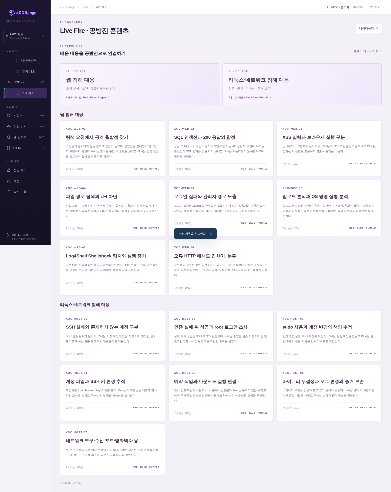
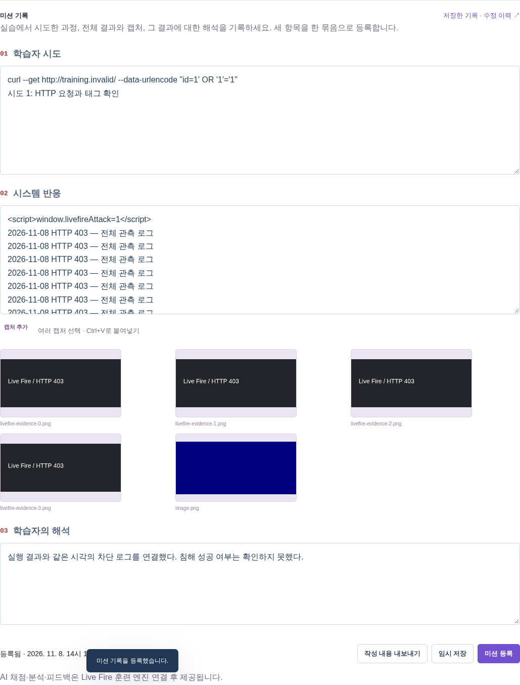
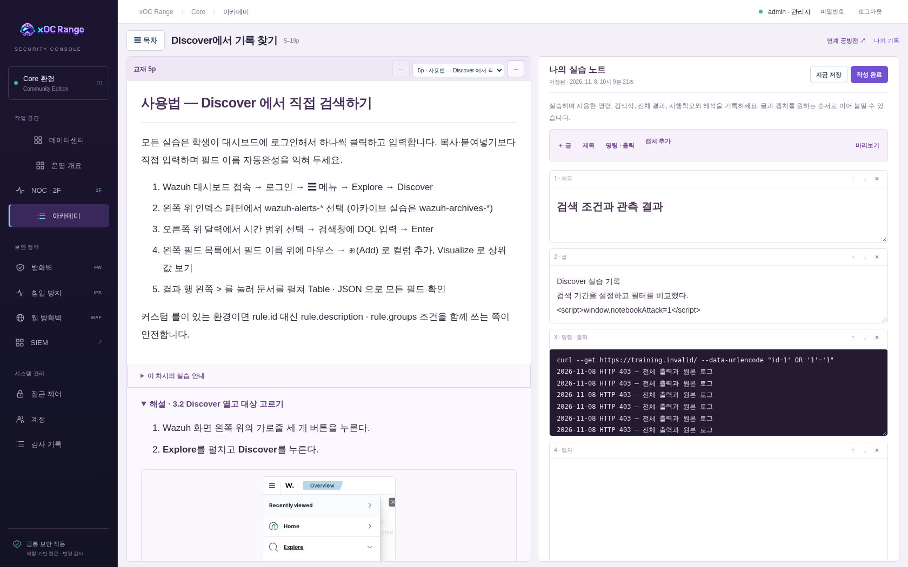
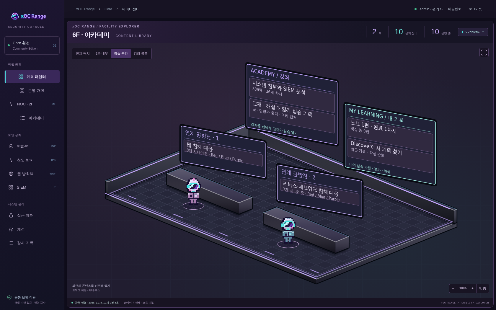
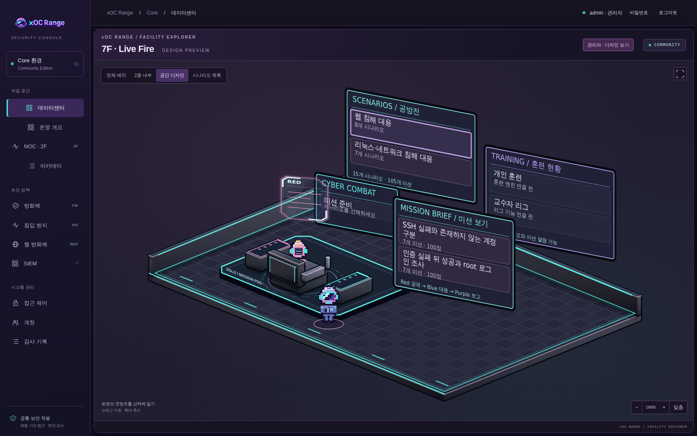
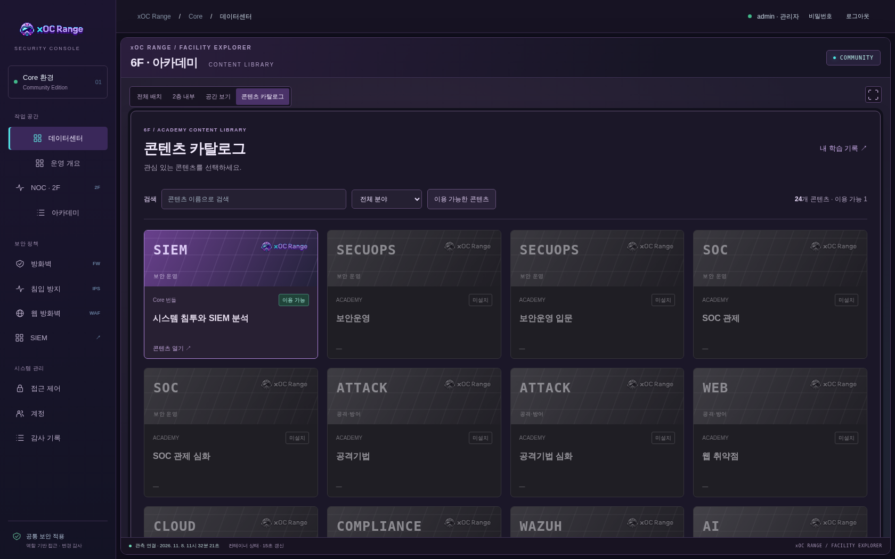
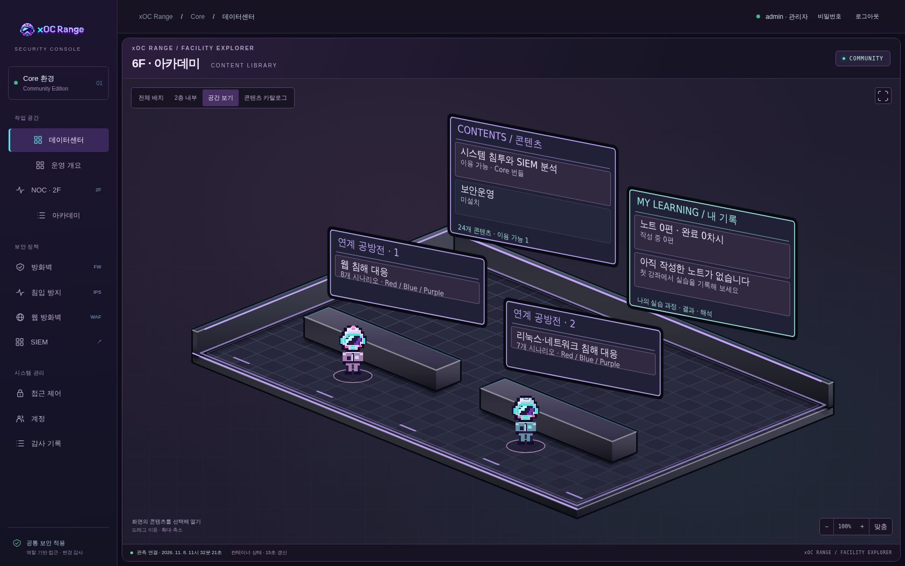

# 아카데미 번들과 개인 실습 기록

Core 로그인 후 왼쪽 **아카데미**를 열거나 `/core/#academy`로 이동한다. 데이터센터 **6층**에서는 24개 콘텐츠 카탈로그를 먼저 열고 이용 가능한 Core 번들을 선택한다. 강좌 → 차시에서 **교재·해설과 미션을 나란히** 사용한다. 관리자용 6F 상용 공간 미리보기에도 실제 Core 번들 링크를 제공한다. 기존 Core 가이드와 상용 층의 권한 경계는 유지한다.

## 화면

| 화면 | 구성 |
|---|---|
| 카탈로그 | 콘텐츠 표지·이름·분야·이용 가능/미설치, 검색·분야·이용 가능 필터. 번들 상세와 진행률은 선택 후 표시 |
| 강좌 | 시작하기·웹 위협·리눅스 위협별 36개 차시 |
| 차시 | 상단 목차 버튼, 왼쪽 페이지별 교재·REV01 해설, 오른쪽 차시별 실습 노트 |
| 실습 | 글·제목·명령/출력·여러 캡처를 순서대로 배치, 자동 임시 저장·지금 저장·작성 완료 |
| 연계 공방전 | 두 과목의 15개 시나리오, Red·Blue·Purple 105개 미션 지시문·배점 미리보기 |
| 나의 기록 | 내 시도 목록, 저장 내용, 캡처, 수정 이력, JSON 내보내기 |

교재는 전체 외부 PPT를 임베드하지 않고 승인된 1–339쪽의 텍스트·표·이미지를 웹으로 배치했다. 설명 화면의 단독 글머리표를 목록으로 묶고 반복 머리글을 줄였다. 자료 내용과 실제 환경의 정합성 검토는 아직 수행하지 않았다. 원본의 검증 문구는 `원본 교재 검증 기록`으로 표시하며 xOC Range에서 재검증했다는 의미로 바꾸지 않는다.

## 출처와 변경

- 교재: [소유자 제공 PPT](https://docs.google.com/presentation/d/1os-JBFoYF857D_eTOJJw37eFkRlo4kXf/edit), 공개 승인 범위 1–339쪽.
- 해설: [hack_ir_with_wazuh_book_1 / manuscript / REV01](https://github.com/mrgrit/hack_ir_with_wazuh_book_1/tree/main/manuscript/REV01), 차시별로 명시한 절과 연결 이미지.
- 구성 참고: [tw2 / contents](https://github.com/mrgrit/tw2/tree/main/contents). 실행 코드는 복사하지 않았다.
- 원본 파일 해시, 원고 커밋, 페이지·절 매핑은 `contents/academy/wazuh-threat-hunting/source-map.json`에 있다.

PPT 340쪽 이후, 전체 원본, 발표자 노트, 매핑하지 않은 원고·이미지는 포함하지 않는다. 공개 페이지 경계와 명시적 파일 목록은 설치 전 검사한다. 캡처의 KT66 표시·IP·검색 결과는 원본 그대로이며 후속 교재 검토 대상이다.

## 저장과 접근

`platform-data/control.sqlite3`에 다음 세 테이블을 추가했다. 기존 계정·장비 정책·감사 기록은 그대로 사용한다.

- `MissionRecord`: 사용자, 강좌·차시·미션 ID, 콘텐츠 버전, 상태, 수정 번호. 기존 `scope=mission`의 입력·출력·해석을 유지하며, 새 `scope=lesson`은 순서가 있는 `notebook` 블록을 저장한다.
- `MissionRevision`: 지금 저장·작성 완료 시 텍스트·노트 블록·상태·첨부 ID를 스냅샷으로 보존한다. 이전 번호는 변경하지 않는다. 자동 저장은 현재 문서와 충돌 검사 번호만 갱신하여 타이핑할 때마다 수동 이력을 소모하지 않는다.
- `MissionEvidence`: 정규화한 WebP 이미지 바이트, 크기·해시·캡션. 이미지도 DB 안에 저장한다.

읽기·쓰기·캡처 조회는 모두 로그인한 본인에게 한정한다. 관리자도 다른 계정의 개인 기록을 이 API로 조회할 수 없다. 조회자 역할도 자신의 실습 기록을 작성한다. 각 저장은 CSRF·Origin, 수정 번호 충돌 검사, 원자적 감사 기록을 적용한다. 계정 전환 시 브라우저 임시 상태를 지운다. 입력한 명령과 결과 텍스트는 실행하지 않고 이스케이프하여 표시한다.

`작성 완료`는 노트가 작성되었다는 표시이며 정답·실습 성공 판정은 아니다. v0.3 노트는 글 또는 캡처를 담아 완료하며, 차시의 실습 항목 완료 상태에 반영한다. 이전 미션 기록은 원래 입력 조건과 수정 이력을 유지하고 실습 안내의 이전 기록 링크나 나의 기록에서 열람한다. AI 채점·분석·피드백은 Live Fire부터 연결하며 Core API에서 실행하지 않는다.

| 항목 | 제한 |
|---|---|
| 실습 노트 | 본문 합계 UTF-8 256 KiB, 블록 200개; 글·제목·명령/출력·캡처 |
| 이전 입력·출력·해석 | 필드당 UTF-8 24,000바이트 유지 |
| 개인 기록 | 2,000건, 기록당 수동 이력 200개, 전체 이력 텍스트 256 MiB; 자동 저장은 수동 이력 한도에 포함하지 않음 |
| 캡처 | 차시 노트당 50장 보관, 이전 미션 기록은 3장 유지, 개인 이미지 합계 512 MiB |
| 업로드 | PNG/JPEG/WebP, API 입력 512 KiB, 8백만 픽셀·한 변 6,000 이하 |
| 저장 이미지 | 최대 2,400px로 축소한 WebP, 메타데이터 제외, 건당 최대 1 MiB |

브라우저는 여러 파일 선택, Ctrl+V 붙여넣기, 끌어놓기를 지원하며 전송 전에 줄인다. 글과 캡처의 순서를 바꾸고 캡처에 설명을 붙일 수 있다. 블록을 제거해도 이전 수정 이력의 캡처는 유지하므로 보관 장수에는 포함된다. SVG·손상 이미지·초과 크기는 거부한다. 입력 후 약 2.5초 동안 변경이 없으면 자동 저장하고, 화면 이동 시에도 저장을 요청하고, 로그아웃은 진행 중인 저장과 마지막 변경 저장을 기다린다. 저장 중·실패 상태를 표시하며 저장되지 않은 내용이 있으면 브라우저 종료 시 경고한다. 저장 전 강제 종료나 네트워크 단절까지 복구를 보장하는 오프라인 편집기는 아니다.

## WAF와 운영

관리 HTTPS의 정확한 기록 저장 POST 경로에서 `input`, `output`, `interpretation`, `notebook` 문자열만 CRS 검사 대상에서 제외한다. `notebook`은 직렬화한 JSON 문자열이며 서버가 타입·필드·텍스트 크기·같은 노트의 이미지 소유권을 다시 검증한다. HTML 블록은 허용하지 않는다. 이미지 POST에서는 `image` 값만 제외한다. 식별자·캡션·다른 필드·다른 API·훈련 트래픽에는 그대로 검사한다. 인증·CSRF·크기 검사·소유권 검사는 API에서 계속 적용한다. 기록 요청 한도는 WAF·미들웨어·Django 모두 750,000바이트다.

`xoc backup create`는 platform-data 볼륨 전체와 콘텐츠를 포함한 릴리스를 백업하므로 개인 기록과 이미지도 함께 복원한다. `academy-reader` 선택 해제는 메뉴·API·콘텐츠 노출을 제거하며 DB 기록을 삭제하지 않는다. 다른 서버로 DB만 복사하지 말고 운영 문서의 백업·복원 절차를 따른다.

## 검증

`tests/test_academy.py`는 공개 범위, 미선언 파일 거부, 필수 입력, 수정 충돌, 개인 기록·이미지 격리, 이미지 정규화·제한, 감사 실패 롤백, CSRF, 선택 해제 시 보존을 검사한다. 실제 HTTPS/WAF·브라우저 검증 결과는 배포 수락 기록에 별도로 남긴다. 콘텐츠 정합성과 실제 타깃별 명령 수행은 이 화면 검증과 별도다.

2026-11-08 격리 VM 검증: 실제 HTTPS/WAF API 33개, Chromium 브라우저 14개 통과. 약 430KB PNG 업로드와 Ctrl+V 캡처 저장, 1,024/1,440px 가로 넘침, 저장 텍스트의 스크립트 비실행을 확인했다. 기록·수정 이력·이미지 25개 DB 행을 백업한 뒤 실제 값을 변경하고 복원하여 전체 값이 동일함을 확인했다. 공개 결과는 [수락 기록](../provenance/academy-acceptance.json)에 유지한다.

본 VM 배포 후 Chromium 검사 15개도 통과했다. 실제 로그인, 교재/이미지 표시, SQL·스크립트 문법의 안전한 텍스트 저장, Ctrl+V 캡처, 완료·재조회·수정 이력, 정확한 미션으로 돌아가기와 1,024/1,440px 레이아웃을 확인했다. 확인용 개인 기록과 첨부만 삭제하여 사용자 기록을 남겨 두었다. 같은 릴리스에서 보안 경로 15개, 관리 입구 6개, 8종 C1·8종 원본 디코딩, SIEM 웹 관제 52개 검사를 통과했다. 전체 Python 검사는 403개를 통과했다.

## v0.2 통합 화면과 Live Fire 연결

6층은 `academy-reader`가 선택된 사용자에게 실제 무료 카탈로그 진입을 제공한다. 기관 구매 콘텐츠나 7층 훈련 실행 권한을 주지 않는다. 아카데미의 각 차시는 연결된 시나리오를 바로 열며, 관리자 7층 화면도 같은 15개 시나리오를 표시한다. 정답과 루브릭은 교관용 YAML에 있고 학습자 API의 명시적 허용 필드에는 포함하지 않는다.

교재·미션 패널은 같은 화면에 배치한다. 설명/실습 탭은 제거했으며 교재 페이지를 넘겨도 입력 내용을 유지한다. 36개 차시와 기존 96개 기록 미션의 ID는 유지했다. 신규 공방전 105개 미션은 별도 콘텐츠이며 기존 Core 기록을 임의로 AI 점수로 변환하지 않는다.

[Live Fire 규격·15개 목록](https://github.com/mrgrit/xocrange_contents/tree/main/battle-scenarios), [참조 엔진 호환 검증](../provenance/livefire-compatibility.json), [v0.2 배포 수락 기록](../provenance/academy-unified-acceptance.json). 위의 최초 배포 검증 수치는 v0.1의 기록이다.

## v0.3 차시 노트와 독서 공간

36개 차시에 각각 개인 노트를 제공한다. 기존 96개 미션은 실습 안내와 이전 기록의 연결을 유지하며 새 노트를 미션당 짧은 답안으로 쪼개지 않는다. 교재의 제목·강조·코드·목록·표는 안전한 HTML로 렌더링하고 명령/검색식의 실행 위치·목적·예상 결과도 표시한다. 원본 HTML과 학습자 입력은 실행하지 않는다. 본문은 17px(좁은 화면 16px), 그림은 원래 비율에 폭 500px·높이 280px 상한을 적용하며 클릭 시 원본을 연다. 고정 차시 목록은 목차 대화상자로 옮기고 상단을 최소화했다.

데이터센터 6층을 확대하면 공간 안의 디스플레이에 본인의 실제 노트·작성 중·완료 차시·최근 작성 링크가, 7층의 디스플레이에는 실제 과목·시나리오·미션 수가 나온다. 강좌·최근 노트·시나리오 항목은 클릭 또는 Enter/Space로 열 수 있다. 메인 건물 화면에 별도 현황 패널을 두지 않는다. 다른 학습자의 개인 노트는 현황에 포함하지 않는다. 실제 리그나 채점기 연결 전에는 가상의 참가 인원·점수·리더보드를 표시하지 않는다. [개인 훈련·리그 설계](LIVE-FIRE-LEAGUES.md)는 구현과 분리해 관리한다.

최종 v0.3 검증: Python 416개, 로컬·본 VM 아카데미 브라우저 각 41개, 본 VM 데이터센터 브라우저 81개를 통과했다. 실제 HTTPS/WAF 경로에서 긴 로그, 캡처 5장, 자동 저장·수동 이력·재접속·로그아웃 직전 저장과 6·7층 화면 링크를 확인했다. 설치기의 보안 경로·관리 입구·8종 정규화/원본 디코딩·SIEM 관제 검사를 함께 통과했다. [검증 기록](../provenance/academy-notebook-acceptance.json)

## 카탈로그 확장

현재 Core 번들 1개와 tw2의 실제 교육 트랙 23개를 같은 크기의 카드로 표시한다. 현재 번들만 이용 가능하며 23개 트랙은 제목·분야 메타데이터만 등록했다. 원본 교재·실습·실행 코드를 설치하지 않았고 미설치 카드는 비활성이며 API로 직접 열어도 404다. 기관 구매 권한이나 설치 완료를 의미하지 않는다. 원본은 [목록 출처](../provenance/academy-catalog-source.json)에 기록한다.

6층 진입과 왼쪽 아카데미 메뉴는 같은 카탈로그를 제공한다. 목록에는 번들의 페이지·차시·진도·실습 안내를 펼치지 않고, 카드를 선택하면 기존 강좌 상세와 36개 차시가 나온다. 검색·분야·이용 가능 조건을 함께 사용할 수 있다. 6층의 공간 보기와 7층 화면에는 실제 콘텐츠를 표시하며 메인 건물 화면에는 수치·학습 현황을 노출하지 않는다.

카탈로그 갱신 검증: Python 417개, 로컬·본 VM 카탈로그 브라우저 각 43개, 본 VM 데이터센터 브라우저 82개를 통과했다. 320–1,680px 화면, 필터 조합, 비활성 카드·직접 API 접근 차단, 카탈로그에서 강좌 선택, 층별 디스플레이와 재로그인 동선을 확인했다. 이 브라우저 검증은 개인 기록을 작성하지 않았으며 배포 전후 학습 기록이 같음을 확인했다. 설치기의 보안 경로·관리 입구·8종 정규화/원본 디코딩·SIEM 관제 검사도 새 릴리스에서 통과했다. [검증 기록](../provenance/academy-catalog-acceptance.json)

## 독립 콘텐츠 저장소

교재·이미지·미션·정답·과목·카탈로그는 [xocrange_contents](https://github.com/mrgrit/xocrange_contents)에서 관리한다. Core는 지정 커밋을 검증해 설치하며 기존 학습 기록의 ID와 저장 위치를 유지한다. [설치·버전 관리](CONTENT-MODULES.md), [분리 배포 검증](../provenance/content-module-acceptance.json).
