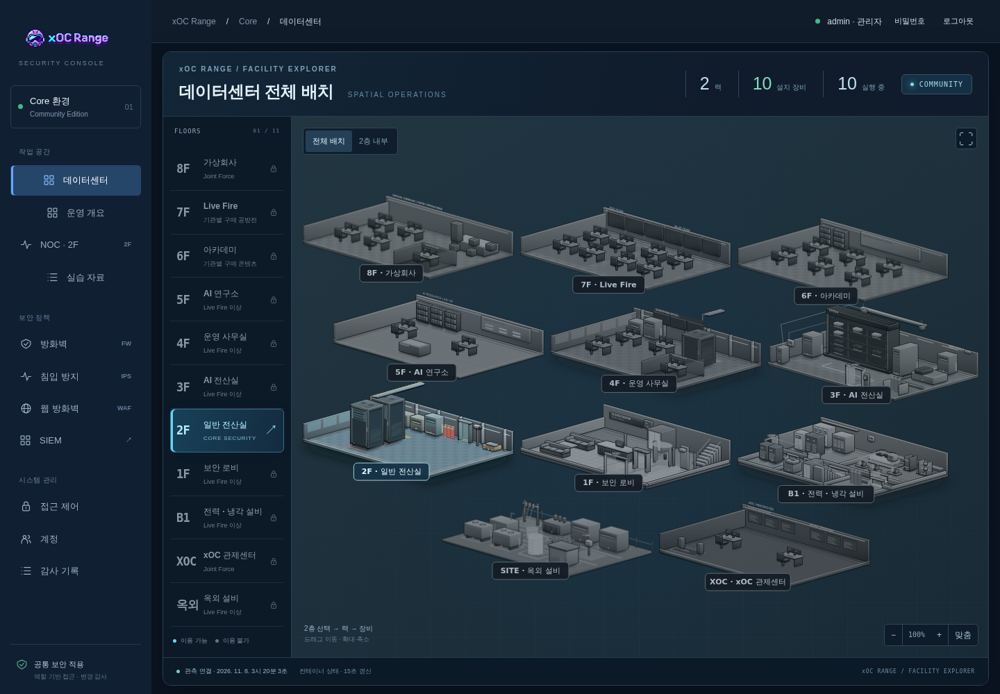
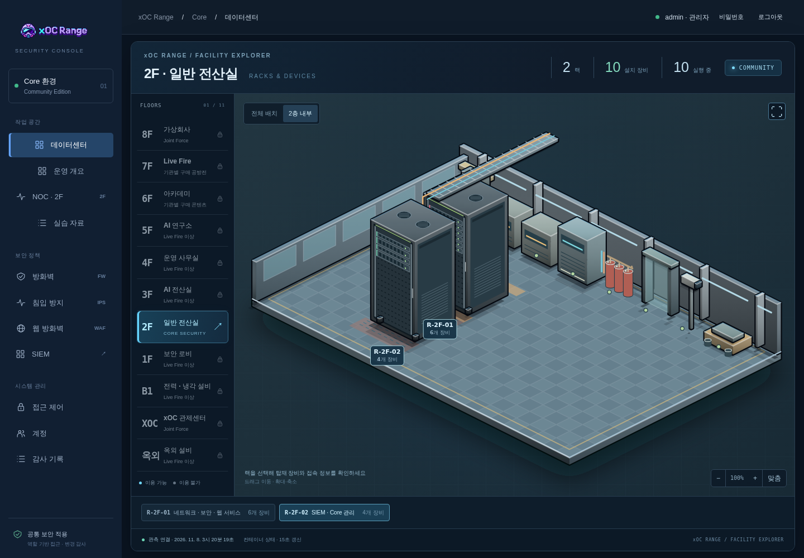
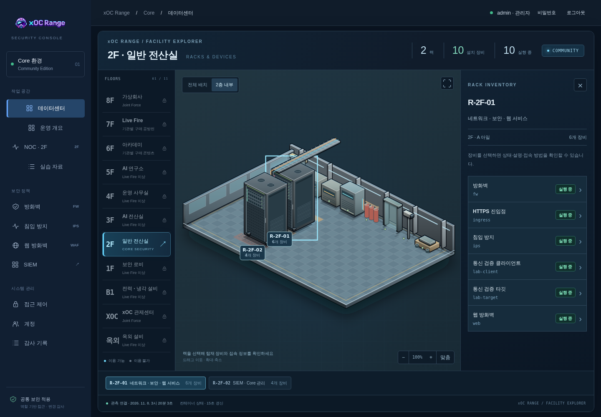
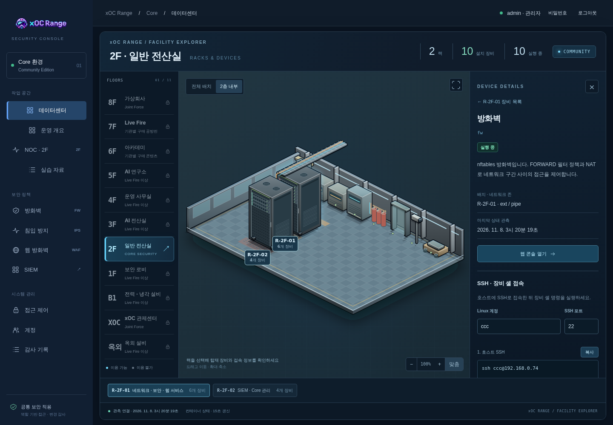
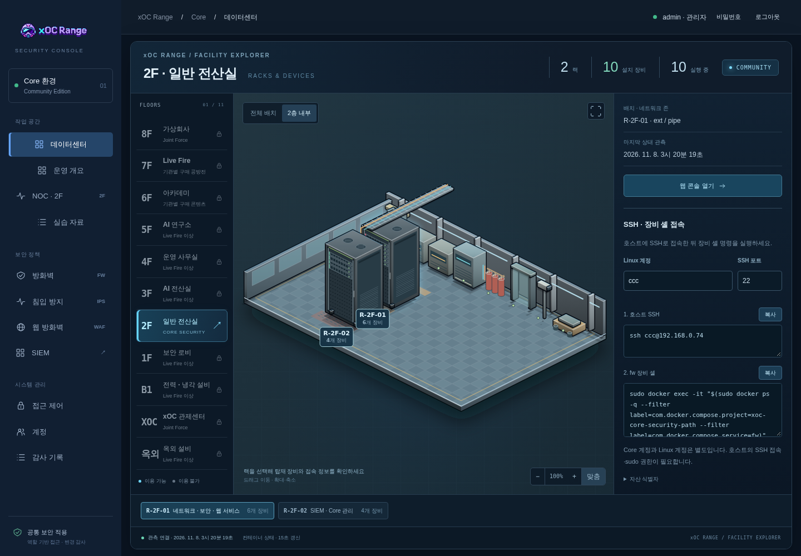

# 데이터센터 시각화 검증 — 2026-11-08

kt66의 층·랙·설비 도형과 재질을 계승하고 6F 아카데미, 7F Live Fire, 8F 가상회사를 추가했다. 전체 층을 화면 비율에 맞춰 사선으로 엇갈려 배치한다. 2F에서 랙을 누르면 장비 목록, 장비를 누르면 상태·설명·웹 콘솔·SSH 및 장비 셸 명령을 표시한다. README 상단에 접속 주소와 계정 확인 방법을 안내한다.

최종 런타임 소스: `642133775a469baa05d5c30b81479754501c474af606861e0e695f10a09d80c0` (161개 파일). Ubuntu 26.04 xoc VM에 전체 설치 프로그램으로 배포했다. 아래 증거는 이 소스와 최종 검증 스크립트를 기준으로 기록한다.

## 검증 결과

| 범위 | 결과 |
|---|---|
| 단위·계약·공통 보안 | 개발 호스트 345개, Ubuntu VM 345개 통과 |
| 실제 HTTPS/WAF | **71개 통과.** 인증·권한·설치 자산·직접 층 접근·구매 쿼리·관측 장애 및 복구 |
| 장비 접속 | **10개 장비 모두 통과.** 화면에 표시한 장비별 명령에서 대화형 옵션만 제거하고 실제 컨테이너 셸 진입을 확인 |
| 관측 장애 | 검증 타깃 중지·복구, 관측 지연 시 미확인 표시, observer 복구 |
| 기존 화면 | **23개 통과.** 운영 개요·NOC·자료실·콘솔 연결·SIEM 새 탭·모바일·로그아웃 |
| 데이터센터 브라우저 | **45개 통과.** 랙 → 목록 → 상세, 상태·설명, 웹 콘솔, SSH/셸 클립보드, 계정·포트 입력, 자동 갱신, 확대·이동·전체화면·키보드·반응형 |
| 설치기 회귀 | 보안 경로 15개, 공통 관리 6개, C1·원본 로그 각각 8종, SIEM HTTPS 52개 통과 |

단위·HTTPS·브라우저 검증 기준 소스는 `b82bfdd2342abc6d884b2bb6fe44f4dfb275620b4277e0fe5e48f4a09f00d1b6`다. 최종 소스는 SVG 파일의 빈 줄 공백만 정리했으며 실행 코드는 동일하다. 최종 소스도 전체 설치기 검사를 거쳤다.

[파일별 해시와 실행 결과](../provenance/datacenter-acceptance.json) · [kt66 원본 출처](../provenance/datacenter-source.json)

## 실제 화면

[노트북](../images/datacenter/laptop.png) · [모바일](../images/datacenter/mobile.png) · [좁은 모바일](../images/datacenter/small-mobile.png)

PC에서는 페이지 세로 스크롤 없이 공간 화면을 채우고, 모바일에서는 층 목록과 상세 패널을 아래로 배치한다. 비활성 층은 회색이며 마우스·키보드로 진입하지 않는다. 직접 API 접근과 기관·티어·구매 쿼리 위조도 서버에서 거부한다. JS 오류·CSP 위반·외부 자산 요청을 검사한다.

## 후속 범위

기관별 구매 이력·유료 콘텐츠·공방전 실행·학생 회사와 에이전트 운영은 C7·M7·M14·M15의 후속 구현 범위다. 이번 Core는 2F 설치 장비를 제공한다. 선택 제외·재포함 설치 행렬은 [K09 검증](K09-VALIDATION.md)에 기록되어 있으며, 이번 변경에서는 API의 선택 해제 차단을 재검사했다. 빈 OS 설치, 호스트 재부팅, 백업 복구, 장기 부하는 이번 UI 변경에서 반복하지 않았다. 기존 kt66 파일과 운영 환경은 수정하지 않았다.
