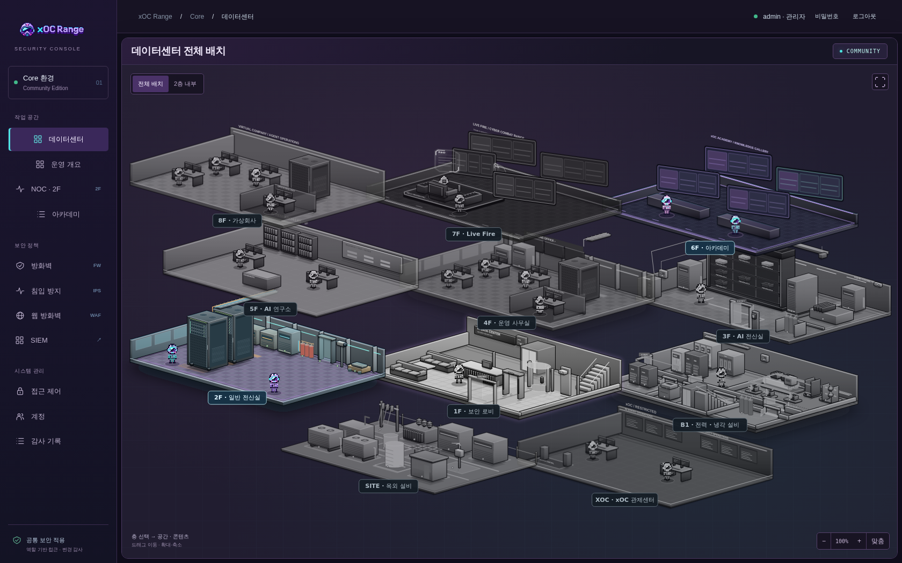
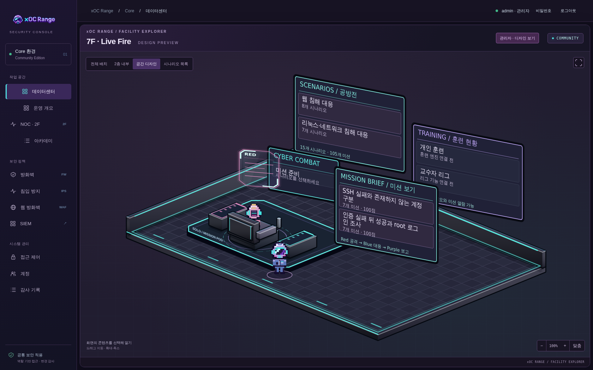

# 데이터센터 공간 화면

로그인 후 기본 화면은 `/core/#datacenter`다. kt66의 층별 데이터센터 표현을 제품의 첫 화면으로 이어가며, 운영 업무용 `/core/#noc`는 유지한다. `noc` 선택 구성요소가 두 화면을 함께 제공한다. `--without noc`이면 탐색 메뉴와 데이터 API가 모두 제거된다.

건물 전체, 2층 내부, 랙 → 장비 목록 → 장비 상세, 시점 확대·축소·이동·초기화, 전체화면을 지원한다. 층과 장비 선택은 키보드로도 조작할 수 있다. 왼쪽 층 안내를 제거하고 캔버스를 넓혔다. PC에서는 화면 높이에 맞춰 공간을 채우며 좁은 화면에서도 확대·이동·장비 상세를 제공한다. 일반 사용자의 비활성 층은 회색이며 진입할 수 없다. **admin은 회색 층을 클릭하거나 Enter/Space로 확대 디자인을 연다.**

## 층 구성과 제품 경계

2026-11-08 사용자 지시에 따라 기존 B1–5F에 6F–8F를 추가했다. xOC 관제센터는 번호가 없는 별도 구역이다.

| 층 | 공간 | 이용 조건 / 연결 범위 |
|---|---|---|
| B1 | 전력·냉각 설비 | Live Fire 이상, M4 시설 모듈 |
| 1F | 보안 로비 | Live Fire 이상 |
| 2F | 일반 전산실 | Community 포함, 현재 설치한 보안 서비스 |
| 3F | AI 전산실 | Live Fire에서 공간 표시; AI 근무자 실행은 Joint Force |
| 4F | 운영 사무실 | Live Fire 이상 |
| 5F | AI 연구소 | Live Fire에서 공간 표시; AI 실행 기능은 해당 모듈 권한 필요 |
| 6F | 아카데미 | **현재 기관이 구매한 콘텐츠만** 열람 |
| 7F | Live Fire | Live Fire 이상 + **현재 기관이 구매한 공방전만** 실행 |
| 8F | Agent Office | **Joint Force**, 학생이 회사를 만들고 에이전트를 배치·운영; M7 + M14 |
| xOC | 제한 관제 구역 | Joint Force |
| 옥외 | 전력·냉각 설비 | Live Fire 이상 |

Community에서는 **2F가 활성**이며 `academy-reader`를 선택 설치하면 **6F도 무료 번들의 진입점으로 활성**이다. 6F의 기관 구매 콘텐츠와 `/core/#academy`의 Core 번들은 권한을 구분한다. 번들 자료를 설치하거나 읽었다고 유료 콘텐츠 권한을 부여하지 않는다.

현재 공간 화면과 관리자 디자인 미리보기, Core 번들 교재·실습 노트·공방전 미션 기록을 제공한다. 상용 실행 권한은 서버에서 검사한다. 기관별 구매 이력/서명 검증, 유료 콘텐츠 공급, 공방전 실행, 학생 회사 생성·에이전트 운영은 아직 구현하지 않았다. C7·M7·M14·M15의 후속 범위이며, 그림에 층이 존재하는 것만으로 상용 기능이 설치·동작한다는 뜻은 아니다.

## 서버 권한 경계

`GET /core/api/datacenter`는 허용된 층 메타데이터와 Community/local의 2F 자산만 반환한다. `GET /core/api/datacenter/floors/2F`도 공통 세션·최초 비밀번호 변경·계정 폐기 검사를 거친다. 다른 알려진 층은 **403**, 알 수 없는 층과 미설치 NOC는 **404**다. 쓰기 메서드는 **405**다. 티어·기관·구매 여부를 쿼리로 주장하면 공통 경계에서 **400**을 반환한다. 클라이언트에 티어 전환/해금 버튼을 두지 않는다.

`GET /core/api/datacenter/design/<floor>`는 **admin 전용**이다. 공통 인증·비밀번호 변경·세션 폐기·쿼리 제한을 적용하고, NOC가 설치된 경우에만 공간 이름과 `preview_only: true`, 빈 `assets`/`actions`를 반환한다. operator/viewer는 403이다. `preview_floors`는 admin에게만 제공하며, `academy-reader`가 없는 경우 `/floors/6F`는 admin도 403이며, 설치된 경우에는 무료 카탈로그 경로만 반환한다. 다른 상용 층의 실행 자산은 admin에게도 반환하지 않는다. 디자인 보기와 상용 실행 권한을 별도 경로로 유지한다.

상용 연결 시 다음 조건은 서버에서 함께 판정해야 한다. 이 목록은 구현 완료 주장이 아니라 다음 모듈의 수용 기준이다.

- 기관은 인증된 세션과 서버가 검증한 소속으로 결정한다. 요청의 `tenant_id`를 권한으로 신뢰하지 않는다.
- 목록·상세·파일 다운로드·실행 시작 각각에서 `기관 + 상품/콘텐츠/시나리오 ID + 동작 + 유효기간 + 티어 + 설치 모듈`을 확인한다. 타 기관의 상품 목록·파일·작업·기록을 노출하지 않는다.
- 6F는 구매한 콘텐츠 ID만 반환한다. 7F는 구매한 공방전 ID만 반환하고 M15 Range Control이 실행을 다시 승인한다. 구매한 콘텐츠가 공방전 실행 권한을 자동 부여하지 않는다.
- 8F의 회사·에이전트·작업은 기관과 학생/팀 소유권으로 분리한다. Joint Force 티어만으로 다른 학생의 회사에 접근할 수 없다. M7의 도구 실행 권한·샌드박스·감사와 M14의 회사 수명주기를 연결한다.
- 만료·철회·계정 비활성·역할 변경 시 재검증한다. UI 비활성 처리와 별도로 직접 API·파일·작업 실행을 거부한다.

## kt66 디자인과 장비 탐색

kt66의 SVG 도형과 재질을 가져와 B1·로비·전산실·운영 사무실·연구소·옥외·xOC를 이어간다. 6F–8F도 같은 바닥·벽·가구 표현으로 확장한다. 전체 배치는 화면 비율에 따라 2–4열을 비교하고 층을 사선으로 엇갈리게 배치한다. 층 바닥 가장자리를 사선으로 겹치고 마지막 행을 가운데 정렬해 각 실을 크게 표시한다. 6F·7F는 바닥 유도 조명과 큰 콘텐츠 디스플레이를 사용한다. 본문 화면은 배경이 비치지 않게 하고, 주변 장비에는 유리와 조명 재질을 유지한다.

2F는 원본의 **R-2F-01 `[3,3]`, R-2F-02 `[3,5]`** 두 랙을 유지한다. R-2F-01에는 ingress/fw/ips/web과 설치 검증 타깃을, R-2F-02에는 siem/indexer/dashboard/platform을 배치한다. C5에 등록된 설치 서비스만 장비 목록에 표시한다.

랙을 선택하면 탑재 장비 목록을 열고, 장비를 선택하면 상태·설명·마지막 관측·웹 콘솔·접속 명령을 표시한다. 웹 콘솔 링크는 선택 설치와 사용자 역할에 허용된 C4 경로만 연결한다. SIEM은 새 탭으로 연다.

Core 컨테이너 접속은 **호스트 SSH → `sudo docker exec`** 순서다. 설치 시 `SUDO_USER`의 유효한 Linux 계정명을 접속 입력의 힌트로 저장하며 사용자가 계정과 포트를 바꿀 수 있다. 각 장비의 Docker 명령은 프로젝트와 등록 서비스 라벨로 컨테이너를 찾는다. 웹 앱이 명령을 실행하거나 SSH 비밀번호를 수집하지 않는다. 직접 SSH가 없는 컨테이너에 접속 가능 주소를 꾸며 넣지 않는다.

LED와 서비스 상태는 기존 호스트 observer의 컨테이너 실행 상태다. 15초 주기로 갱신하며 45초 이상 지난 관측은 미확인으로 바뀐다. 선택한 랙·장비·시점·상세 패널 스크롤은 갱신 후에도 유지한다.

SVG/CSS는 Core 내부 정적 자산을 사용한다. 원본의 건축 도형과 13명 직무·배치·크기를 가져오며 기존 kt66의 접속 정보·제어 API·envsim·에이전트 실행기는 연결하지 않는다. 기존 CSP, Docker 소켓 미노출, 호스트 권한 분리를 유지한다.

## 검증

- `tests/test_datacenter.py`: 인증, 3역할, 층 직접 접근, 구매/기관/티어 위조, 선택 해제, 관측 지연, 외부 tenant 자산 제외, 세션 폐기.
- `tests/integration/workspaces.py`: 실제 HTTPS/WAF 경로, 층 차단, 선택 자산 일치, observer 장애와 복구.
- `tests/browser/datacenter_browser.py`: 기본 진입, 관리자 미리보기·일반 사용자 회색 잠금, 아바타 배치·크기, 카탈로그·미션 화면, 키보드, 랙·장비 순차 선택, 웹 콘솔, SSH/장비 셸 복사, 자동 갱신 후 시점 유지, 화면 크기·전체화면·콘솔 오류.

실제 실행 결과와 화면은 [검증 기록](DATACENTER-VALIDATION.md)에 기록한다. 참고한 원본은 [출처](../provenance/datacenter-source.json)에 남긴다.

## 로고 색상과 직무별 아바타

보라색을 기본색, 청록색을 선택·강조색으로 사용한다. 잠긴 층은 회색으로 남겨두고 관리자 확대 화면에서는 원래 재질과 아바타 색을 표시한다. 기존 13명은 kt66의 층별 인원·좌표·24×44 픽셀 비율을 계승한다. 서 있는 인물 너비는 24, 앉은 인물은 22 SVG 단위다. 화면 확대에 따라 장비와 함께 커진다.

| 층 | 인원 | 배치 기준 |
|---|---:|---|
| B1 / 1F / 3F | 각 1 | kt66의 시설·물리보안·GPU 담당 위치 |
| 2F | 2 | 네트워크·시스템 담당 원래 위치 |
| 4F | 4 | 직원 3명 + 운영 리드 |
| 5F / xOC | 각 2 | 연구·평가 / 감독·SOC 콘솔 |
| 옥외 | 0 | kt66 원본과 동일 |
| 6F | 0 | 콘텐츠 카탈로그·디스플레이 공간 |
| 7F | 1 | 조종석에 앉은 아바타 한 명 |
| 8F | 4 | 4F의 직원 3명 + 리드 배치를 계승 |

모든 아바타는 xOC 로고의 헬멧과 점프슈트를 입는다. 화면에 배치한 직무별 14개 색 조합과 리드·엔지니어·보안·연구·감사·전문 담당의 6종 헬멧 표식을 사용한다. 정적 그림이며 상태 링이나 활동 수치를 만들어 표시하지 않는다.

6F·7F 화면 구성과 tw2 참조 범위는 [상용 층 디자인](COMMERCIAL-FLOOR-DESIGN.md), 이번 검증은 [후속 검증 기록](FLOOR-DESIGN-VALIDATION.md)에 기록한다.

## 아카데미 콘텐츠 연결 갱신

아카데미 v0.2부터 `academy-reader`가 설치된 경우 **6층을 실제 무료 카탈로그 진입점으로 활성화**한다. 6층 API는 카탈로그 경로만 반환하고 상용 자산이나 실행 권한을 반환하지 않는다. 모듈을 선택 해제하면 진입을 차단한다. 관리자 7층의 화면 구성은 새 Live Fire 15개 시나리오로 연결하며 제출·채점은 비활성이다. 이 동작이 이전의 6층 전체 회색 잠금 설명보다 우선한다.

## 6·7층 공간 안의 실제 콘텐츠 디스플레이

6층을 선택하면 콘텐츠 카탈로그가 먼저 열린다. 24개 카드 중 Core 번들 하나만 이용 가능하며 미설치 콘텐츠는 회색으로 잠긴다. 페이지·차시·실습 안내는 번들을 선택한 뒤 표시한다. 공간 보기로 전환하면 학습 공간을 확대한다. 공간 안의 큰 디스플레이에는 실제 콘텐츠 제목·설치 여부, 로그인한 본인의 노트 수·작성 중·완료 차시·최근 작성 링크를 표시한다. 강좌와 노트 항목을 클릭하거나 Enter/Space로 열 수 있다. 카탈로그에는 검색·분야·이용 가능 필터를 제공한다.

7층의 관리자 공간에는 등록된 2개 과목·15개 시나리오·105개 미션과 실제 시나리오 링크를 표시한다. 단좌 훈련석과 아바타는 유지하고, 화면 본문은 투명 선 장식 대신 불투명한 바탕과 큰 글자로 표시한다. 메인 건물 화면에는 별도 패널, 장비 수·관측 상태, 개인 학습 내용 없이 데이터센터를 크게 표시한다. 층에서 되돌아왔을 때도 같은 원칙을 적용한다. 왼쪽 데이터센터 메뉴와 데이터센터에서 재로그인할 때는 건물 전체 배치를 연다.

현재 훈련 실행·AI 채점·리그는 연결 전이므로 참가 인원이나 점수를 만들지 않는다. 개인 훈련과 교수자 리그의 후속 연결은 [설계 문서](LIVE-FIRE-LEAGUES.md)에 정리했다. 학습 현황은 본인 소유 기록만 집계하며 아카데미를 선택 해제하면 강좌 진입을 차단한다.

[카탈로그·전체 배치 갱신 검증](../provenance/academy-catalog-acceptance.json): 로컬·본 VM 카탈로그 브라우저 각 43개와 본 VM 데이터센터 브라우저 82개를 통과했다. 메인·층 복귀·왼쪽 메뉴·재로그인에서 건물 전체만 표시하는 동작을 검증했다.

층 보기 도구는 현재 화면에 맞춰 표시한다. `2층 내부`는 2층 안에서만 표시하며 전체 배치와 다른 층에는 노출하지 않는다. 다른 층에서 2층으로 이동할 때는 전체 배치의 2층을 선택한다.

층별 메뉴 수정은 본 VM의 데이터센터 브라우저 83개 검사로 확인했다. 전체 배치·6층·관리자 미리보기 층에서 2층 전용 버튼이 없고, 2층에서만 표시되는지 검사했다. 작은 화면에서 전체 배치의 2층 선택도 확인했다. [검증 기록](../provenance/floor-toolbar-acceptance.json)

6·7층 상단 제목과 디스플레이는 같은 투영 각도를 사용한다. 전체 배치와 확대 화면 모두 제목이 디스플레이 윗면과 평행하며, 확대했을 때 제목이 화면 뒤에 가려지지 않도록 높이를 맞춘다. 8층의 층 이름과 상단 표기는 `Agent Office` / `AGENT OFFICE`로 통일한다.
