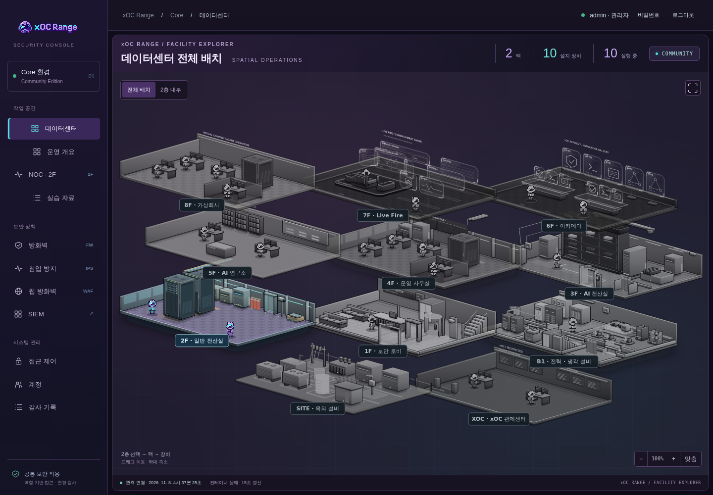
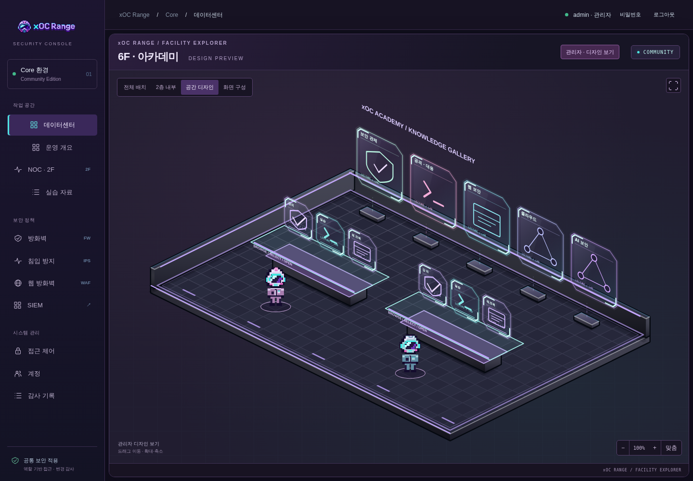
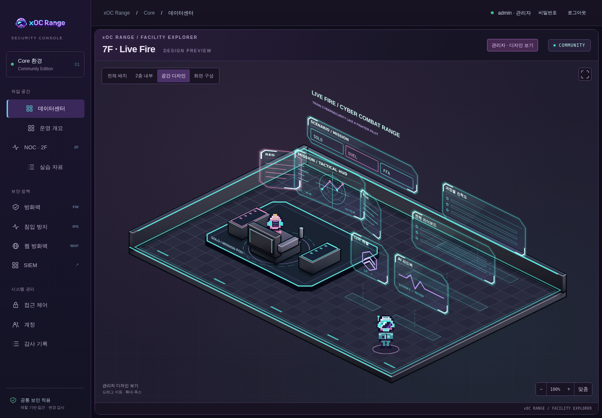
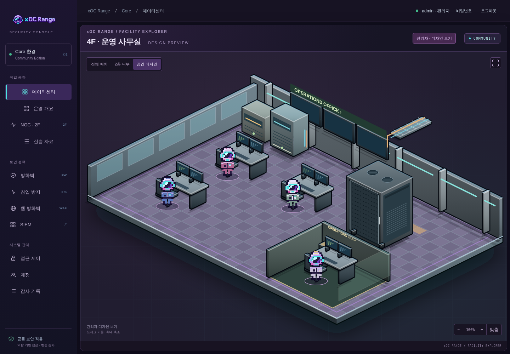

# 층 디자인 · 아바타 검증 — 2026-11-08

전체 배치의 층 안내를 제거하고 각 실을 확대했다. 6F는 투명 콘텐츠 카드·터치 테이블을 갖춘 디지털 라이브러리, 7F는 단좌 조종석·투명 HUD·부유형 훈련 정보 패널로 재구성했다. 8F에는 운영 랙을 두고, 모든 인물에 xOC 헬멧과 직무별 점프슈트를 적용했다. admin은 회색 층을 확대해서 보고 6F·7F의 공간과 화면 구성을 전환할 수 있다.

최종 런타임 소스는 `010e6bf83d7de78990d27b88c1278817685a4564da9da7712453d3833f09d82e` (164개 파일)다. Ubuntu xoc VM에서 전체 설치기를 실행했다. 아래 결과와 화면은 이 소스를 기준으로 한다.

## 결과

| 범위 | 결과 |
|---|---|
| 단위·계약·공통 보안 | 개발 호스트 349개, VM 349개 통과 |
| 데이터센터 브라우저 | 84개 통과: 관리자 10개 공간 확대, 일반 사용자 잠금 UI, 카탈로그 검색·분류·상세, 미션 선택, 실행 버튼 비활성, 랙·장비·SSH 복사·전체화면·반응형 |
| 기존 관리 화면 | 23개 통과: 운영 개요·NOC·자료실·장비 콘솔·SIEM 새 탭·모바일·로그아웃 |
| 실제 HTTPS/WAF | 85개 통과: 관리자 디자인 API, 실제 상용 층 차단, viewer 직접 접근 거부, 구매 쿼리 거부, 자산·권한·세션 |
| 장비 접속·관측 | 10개 컨테이너 셸 접속, 검증 타깃 중지·복구, 오래된 관측의 미확인 표시와 observer 복구 |
| 전체 설치기 | 보안 경로 15개, 공통 관리 6개, C1·원본 로그 각 8종, SIEM HTTPS 52개 통과 |

브라우저 JS 오류·CSP 위반·SVG 속성 오류는 없었다. 일반 사용자 UI는 서버가 반환하는 비관리자 계약으로 검사했고, 실제 viewer의 디자인 API 접근 거부는 별도 HTTPS 검사로 확인했다. 관리자 디자인 API는 빈 자산·동작 목록을 반환하며 실제 상용 층 API는 계속 403이다. 미리보기의 선택·검색은 브라우저 안에서 수행한다.

kt66의 기존 13명은 인원·좌표·24×44 비율과 서 있는 너비 24 / 앉은 너비 22를 유지했다. 추가 층은 6F 2명, 7F 2명, 8F 4명이다. 17개 직무 색 조합·6종 헬멧 표식을 적용했다. 7F 좌석은 HUD 방향으로 배치하고 불투명 등받이가 몸과 먼 쪽 팔걸이를 가리도록 그렸다. 공간·화면 표기는 `CYBER COMBAT RANGE`로 통일했다. 에이전트 실행은 연결하지 않았다.

전체 배치에서 2F 실의 가로 크기는 직전 배포에 비해 1600px 화면에서 **20.6%**, 1440px에서 **9.7%**, 1280px에서 **28.6%** 증가했다. 동일한 화면 크기의 SVG 경계로 비교했다. [측정값](../provenance/floor-layout-comparison.json)

[런타임·검사 증거](../provenance/floor-design-acceptance.json) · [브라우저 검사와 인물 좌표](../provenance/floor-design-browser.json) · [기존 화면 검사](../provenance/floor-design-workspaces-browser.json) · [참조 소스](../provenance/floor-design-source.json)

설치 시점 SIEM 수집기는 기존 미처리 큐가 남아 `degraded`로 보고했다. 8종 디코딩·색인·검색 검사는 통과했으며, 지속 처리량과 적체 해소는 이번 디자인 검증에 포함하지 않았다. 큐 상태는 위 런타임 증거에 함께 기록했다.

## 배포 화면

[6F 카탈로그](../images/floor-design/academy-catalog.png) · [7F 미션 대시보드](../images/floor-design/live-fire-dashboard.png) · [8F 가상회사](../images/floor-design/company.png) · [모바일](../images/floor-design/mobile.png)

## 후속 구현

기관별 구매 콘텐츠·공방전 실행, 개인 레벨·진척도·리더보드·AI 피드백 데이터 연결, 학생 회사와 에이전트 실행은 C7·M7·M14·M15 후속 범위다. 이번에는 디자인과 관리자 보기 경계를 구현했다. [tw2 기능 대응과 상용 연결](COMMERCIAL-FLOOR-DESIGN.md)

빈 OS 설치·호스트 재부팅·장기 부하는 이번 디자인 변경에서 반복하지 않았다. kt66·tw2 참조 파일은 수정하지 않았다.
