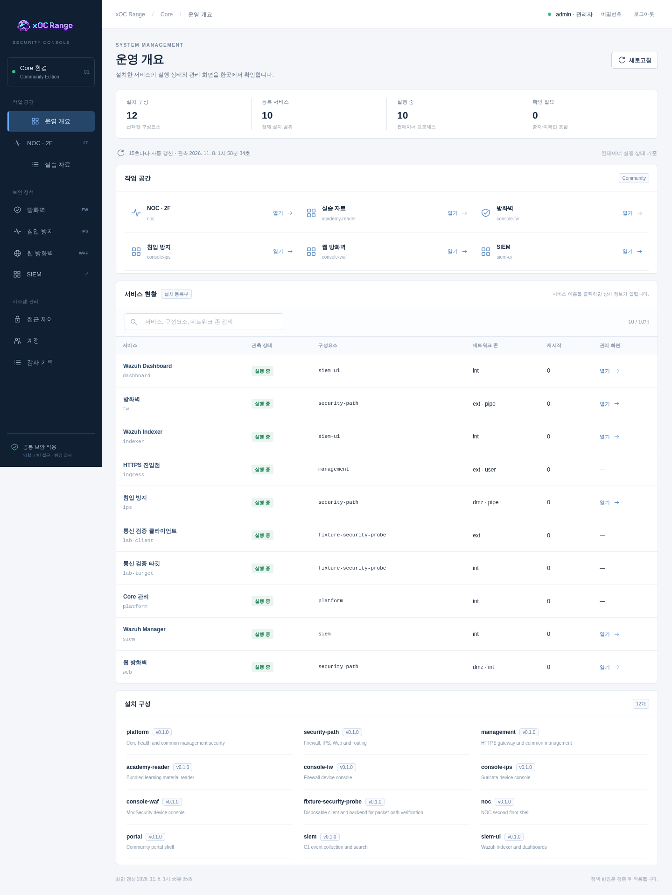
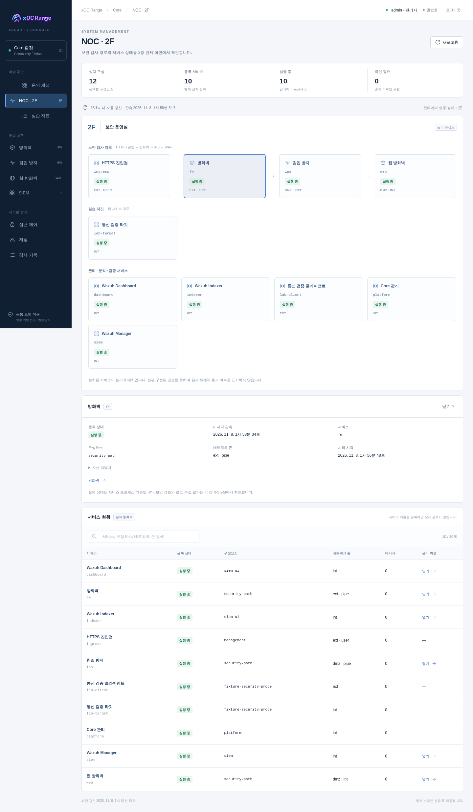
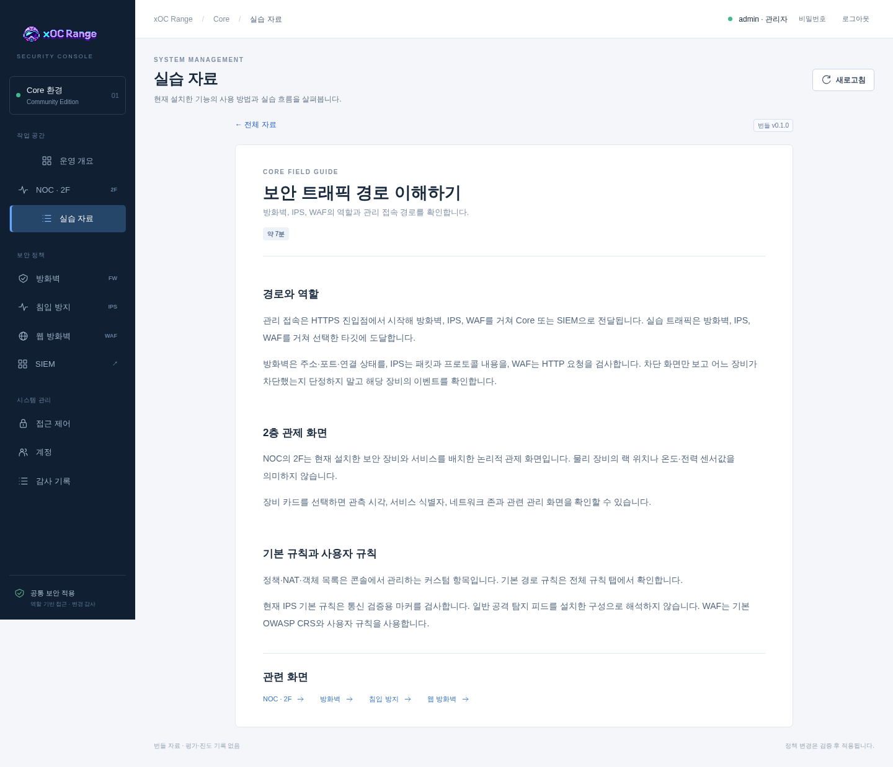

# K09 검증 기록 — 2026-11-08

설치 등록부(C4/C5), 운영 개요, NOC 2층, 번들 자료실을 Ubuntu 26.04 VM에 배포했다. 최종 런타임 소스는 `8273304e6e82be621b9cc356ef58fb0b88a21a9c892ba2f0e341fa654d0a70de`이며, 156개 파일의 실제 배포 내용이 설치 manifest와 일치함을 확인했다. [기계 판독 증거](../provenance/k09-acceptance.json)에 파일 해시와 검증 항목을 남긴다.

## 확인한 결과

| 범위 | 결과 |
|---|---|
| 단위·계약·공통 보안 | 개발 호스트 322개 통과. 최종 설치 안내 문구 변경 후 설치기 15개 추가 확인. 최종 소스의 Ubuntu VM 테스트 322개 통과(25.37초) |
| 실제 HTTPS·권한·C4/C5·자료실·장애 | 39개 통과. 익명 차단, 조회자 접근, 초기 비밀번호 변경 강제, 세션 폐기, 자료 경로 제한, 비밀값 미노출 |
| 서비스·관측 장애 | 검증 타깃 중지→중지 표시→관리 접속 유지→타깃 복구. 관측 타이머 정지 및 오래된 시각 주입→미확인 표시→타이머 복구 |
| 기본 구성 브라우저 | 20개 통과. 기본 포털, 검색, 2F·4개 경로 장비, 상세→콘솔 연결, 4개 가이드, SIEM 새 탭, 모바일 3화면·JS 오류 없음 |
| 선택 제외 | `portal`, `noc`, `academy-reader`, `console-ips`, `siem` 제외 설치 성공. API 29개·브라우저 5개 통과 |
| 선택 해제/재포함 | 제외한 기능의 메뉴·요청 없음, 자료실 번들 제거, 공통 계정 유지. 기본 선택 복원 후 동일 자산 ID·자료실 복구·타깃 HTTP 정상·관측 타이머 실행 확인 |
| 설치기 보안 회귀 | 실제 경로 15개, 공통 관리 6개, 8종 C1·8종 native receipt, SIEM HTTPS/WAF 52개 모두 통과 |

선택 제외 검증 소스는 `4ee1a552…`이며, 최종 소스에서는 선택 구성 안내 문구만 다르게 출력한다. 상세 SHA와 단계별 범위는 증거 JSON에 구분했다. 설치·복원은 동일 셸 설치기를 사용했다. 추가 컨테이너·공개 포트·Docker 소켓 마운트는 도입하지 않았다. 테스트용 조회자 계정은 삭제했고 감사 기록은 보존했다.

## 실제 화면

### 운영 개요

### NOC 2층

### 번들 자료실

[모바일 화면](../images/k09/mobile.png)도 확인했다. 화면에는 설치한 구성만 나오며 물리 시설·AI 근무자·가상 트래픽 수치는 표시하지 않는다.

## 재현 도구와 한계

- `tests/test_registry.py`: C4 소유권·충돌, 자산 ID 안정성, 인증·자료 경로, 오래된 관측 및 구성 제외.
- `tests/integration/workspaces.py`: 격리 VM에서 실제 HTTPS와 선택 구성을 검증. `--exercise-observer`는 검증용 타깃을 잠시 중지하고 관측 지연을 주입한 뒤 복구한다.
- `tests/browser/workspaces_browser.py`: 실제 브라우저·새 탭·반응형 화면. `--reduced`는 위 선택 제외 구성을 확인한다.
- 실제 실행 상태는 컨테이너 수준이다. 서비스 전 기능·로그 수집 완전성 판정은 각각의 검증 경로와 구분한다.
- 이번 소스에서 전체 호스트 재부팅·빈 OS 재설치는 반복하지 않았다. 관측 타이머의 자동 시작 등록과 서비스 재시작은 확인했다.
- K05 실제 입문 타깃, K10 C7·전체 모듈 수명주기, K11 백업/복구·장기 부하와 K12 RC는 남아 있다. K09 완료를 전체 Community 출시 완료로 표시하지 않는다.
