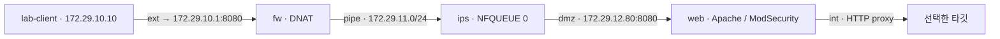

# Ubuntu 26.04 보안 경로 검증 VM

상태: 실행 구성·검증 코드를 준비했고, 실제 VM build/통신 검증은 아직 수행하지 않았다. 기존 kt66 호스트에서 이 절차를 실행하지 않는다.

## VM 준비

사용자가 새 Core 검증 호스트로 Ubuntu Server **26.04 LTS x86_64**를 선택했다. GUI 없는 최소 구성으로 설치하고 OpenSSH·sudo 사용 가능 계정을 준비한다. 패키지와 이미지를 다운로드할 인터넷 연결이 필요하다. 현재 검증은 관리용 NIC 1개와 Docker 내부 네트워크를 사용한다. GPU·중첩 가상화는 필요하지 않다.

| 자원 | Core 전체 개발을 위한 초기 권장 예산 |
|---|---|
| CPU | 8 vCPU |
| RAM | 32GB; 물리 호스트 여유가 부족하면 16GB로 시작 후 증설 |
| OS 디스크 | 80GB |
| 별도 데이터 디스크 | 300GB SSD, 환경이 지원하면 동적 할당 |

위 수치는 실측된 제품 최소 사양이 아니다. Wazuh 중앙 구성만으로도 소규모 배포에 4 vCPU·8GiB RAM을 권장하므로, Core 장비·타깃·화면·빌드 작업을 더할 여유를 산정했다. [Wazuh 권장 사양](https://documentation.wazuh.com/current/quickstart.html)

Wazuh quickstart의 현재 네이티브 설치 OS 목록에는 Ubuntu 26.04가 없다. 위 사양표는 자원 예산 참고이며, K06에서는 검증된 컨테이너 이미지를 통해 통합한다. 새 호스트에서 Wazuh 네이티브 설치 지원까지 확인된 것으로 취급하지 않는다.

이번 보안 경로만 검증할 때는 더 작은 VM으로 시작할 수 있지만 Core 전체 개발에는 위 예산을 권장한다. 메모리·CPU·가상 디스크는 일반적으로 OS 재설치 없이 증설할 수 있으며, 하이퍼바이저와 파일시스템에 따라 재부팅·파일시스템 확장이 필요하다. 모든 상용 모듈·Windows·동시 학생·로컬 AI를 한 VM에서 구동할 사양은 별도로 측정한다.

Docker·SIEM 데이터를 별도 디스크로 배치하는 작업은 VM의 장치 구성을 확인한 뒤 수행한다. Docker 버전에 따른 Docker daemon 및 containerd 저장 위치를 함께 확인하고, 이미지·로그 보관량을 제한한다.

## 격리 경로



ext/pipe/dmz는 내부 브리지이고 masquerade를 끈다. web의 IP forwarding은 끄고 HTTP 프록시만 허용한다. WAF까지 클라이언트의 L3 출처를 보존하며, WAF는 외부에서 전달한 X-Forwarded-For를 제거한 뒤 실제 출처를 backend에 전달한다. 이 동작은 현재 설계·설정이며 VM 검증을 통과해야 완료로 판정한다.

fw·IPS·WAF에는 호스트 포트·host network·privileged·Docker socket·host bind mount를 사용하지 않는다. bootstrap platform의 기존 `127.0.0.1:18080` health 포트만 남는다. 장비 콘솔·SSH·Wazuh agent·평가 수집은 장비 이미지에 포함하지 않는다.

## 자동 설치

빈 VM의 일반 설치 경로는 `sudo bash install.sh`다. 의존성 준비, Docker 설치, 커널·네트워크 전제 조건, 이미지 빌드, 통신 검증, 부팅 등록을 설치기가 처리한다. [자동 설치기](INSTALLER.md)를 참조한다. 아래 명령은 개발자가 개별 단계를 조사할 때 사용하는 절차다.

## 개발자 개별 실행 순서

1. 빈 VM에 [Docker 공식 Ubuntu 설치 절차](https://docs.docker.com/engine/install/ubuntu/)로 Engine·Compose 플러그인을 설치한다. 이 단계에서 기존 서버의 Docker 설정을 복사하지 않는다.
2. 저장소를 새로 체크아웃하고 Python venv에 설치한다.

```bash
sudo apt update
sudo apt install -y git python3-venv
git clone https://github.com/mrgrit/xocrange.git
cd xocrange
python3 -m venv .venv
. .venv/bin/activate
python -m pip install -e '.[test]'
python -m pytest -q
```

3. 전용 VM에서 네트워크 전제 조건을 준비한다. 기존 sysctl 값을 기록하고, 이후 복구 시 그 값으로 되돌린다. Docker 재시작 후에도 값을 다시 확인한다.

```bash
sudo modprobe -a br_netfilter nfnetlink_queue
cat /proc/sys/net/bridge/bridge-nf-call-iptables
sudo sysctl -w net.bridge.bridge-nf-call-iptables=0
```

이 변경은 해당 VM 호스트의 브리지 처리를 바꾼다. 기존 kt66의 netglue와 달리 DOCKER-USER 체인이나 호스트 nftables 규칙을 초기화하지 않는다. `xoc lab`은 이 sysctl을 자동 변경하지 않고 필요한 상태를 확인한다.

4. 실행 계획을 생성하고 검증한다. `--output`은 새 이름을 사용한다. 명령을 실행하는 계정에 해당 VM의 Docker 사용 권한이 있어야 한다.

```bash
xoc plan --preset security-path --allow-experimental \
  --allow-fixtures --include fixture-security-probe --output security-lab
docker compose -f .local/plans/security-lab/compose.yaml config --quiet
xoc lab check --plan security-lab
xoc lab up --plan security-lab --isolated-vm
xoc lab verify --plan security-lab --isolated-vm
```

`check`는 Ubuntu 26.04 VM, 로컬 rootful Docker, Compose, bridge netfilter, NFQUEUE 모듈, 전용 Docker 상태, 서브넷·호스트 경로 충돌을 확인한다. 다른 프로젝트 컨테이너가 있으면 중단한다. 기준 서브넷은 `172.29.10/24`, `172.29.11/24`, `172.29.12/24`다.

실행 전 lock과 현재 소스 해시, 생성 Compose를 다시 비교한다. 직접 수정한 Compose나 오래된 계획은 거부한다. `up` 성공은 컨테이너 시작을 의미하며 보안 경로 검증 성공을 의미하지 않는다.

## 검증 항목과 결과

`verify`는 명시적으로 설치한 무해한 fixture 클라이언트·backend만 사용한다.

- 기본 화면과 선택 타깃의 정상 응답.
- fw 전달 카운터와 IPS 검사 카운터 증가.
- WAF까지 출처 IP 보존, backend의 X-Forwarded-For 위조 방지.
- 다른 포트 차단, WAF·backend 직접 우회 불가.
- WAF 표식 요청의 403과 새 C1 차단 이벤트.
- IPS 표식 요청의 차단과 새 C1 차단 이벤트.
- IPS 중단 시 통신 차단, 재시작 후 정상 통신 복구.

검증 시작 시 로그 offset을 기록하고 이번 실행에 추가된 로그만 증거로 사용한다. 과거 알림으로 새 요청 차단을 입증하지 않는다. 결과와 정규화한 이벤트는 `.local/lab-results/`의 비공개 JSON에 보관한다. 하나라도 실패하면 종료 코드 2다.

## 종료와 조사

```bash
xoc lab down --plan security-lab --isolated-vm
```

기동 오류는 해당 프로젝트의 빌드 및 컨테이너 로그로 조사한다. 코드 변경 전에는 실행한 구성을 먼저 종료한다. 계획 파일을 변경해 CLI 검증에서 거부된 경우에는 검토한 기존 Compose와 프로젝트 이름 `xoc-core-security-path`를 명시해 Docker Compose에서 종료한다. 다른 프로젝트를 대상으로 `down`, prune, 방화벽 초기화를 실행하지 않는다.

장비 로그는 현재 크기가 제한된 tmpfs이며 재시작하면 사라질 수 있다. 영구 보관·회전·SIEM 연계는 K06에서 구현한다. `lab down`은 호스트 sysctl을 복구하지 않으므로 검증 종료 시 기록한 값을 복원한다.

## 검증 후 추가할 것

Docker 이미지·apt 패키지 digest/버전 고정, 일반 Suricata 룰 공급자, 로그 영속성, 외부 실습 클라이언트 진입, TLS, 장비 health/readiness, 인증·콘솔 연결은 후속 범위다. WAF 이미지는 배포판의 ModSecurity·CRS 패키지를 사용하고, Core 자체 표식 룰로 경로를 별도 확인한다.
