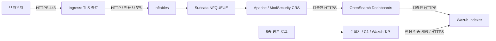

# Core SIEM 웹 관제와 WAF 예외

`siem-ui`는 `siem`·`security-path`에 의존하는 선택형 Community 구성요소다. Wazuh 4.14.10 분석 결과를 같은 버전의 Wazuh Indexer에 저장하고, 내장 OpenSearch 2.19.6에 맞춘 OpenSearch Dashboards 2.19.6으로 조회한다. Wazuh 에이전트 관리 플러그인/API를 제공하는 구성은 아니다. **현재 화면은 실험 구성이다.** 정식 Wazuh Manager·Indexer·Dashboard와 원본 경보 유지의 최종 목표는 [ADR 0007](../adr/0007-wazuh-roadmap-alignment.md), 단계별 상태는 [로드맵 실행 상태](ROADMAP-STATUS.md)를 따른다.

## 설치와 접속

```bash
sudo bash install.sh
sudo xoc siem credentials
sudo xoc siem status

# DNS를 사용하는 배포
sudo bash install.sh --public-host siem.example.test
# 웹 관제만 제외 / SIEM 전체 제외
sudo bash install.sh --without siem-ui
sudo bash install.sh --without siem
```

HTTPS 주소는 기본 `https://VM주소/siem/`다. 외부에는 80(HTTPS 리다이렉트), 443만 공개한다. 9200·5601을 호스트에 공개하지 않는다. 관리자 비밀번호, Dashboard 서비스 비밀번호, 색인 전송 계정, 쿠키 암호화 키를 설치마다 무작위로 생성하며 기존 설치에서는 유지한다. 비밀번호를 Compose 환경 변수·이미지·Git·설치 로그에 넣지 않는다. 로컬 관리자만 `/var/lib/xocrange/ui/credentials.json`을 읽을 수 있다.

설치기는 개인 로컬 CA와 서버 인증서를 생성한다. 접속 PC에 `/etc/xocrange/ca.crt`를 신뢰 등록하면 브라우저 인증서 경고가 없어진다. 공개 CA 인증서만 `https://VM주소/ca.crt`에서도 받을 수 있다. CA 개인 키는 VM의 관리자 전용 디렉토리에 남는다. DNS 이름을 지정하면 접속 PC에서 그 이름이 VM으로 해석되어야 한다. 관리자 계정의 외부 비밀번호 변경과 설치기 자격 증명 동기화, 공개 CA 인증서 수명 관리는 별도 운영 기능으로 남아 있다.

VM 요구 조건은 웹 관제 포함 시 최소 8 GiB RAM, 기존 설치기와 동일한 amd64 Ubuntu Server 26.04다. Docker·TLS·`vm.max_map_count`·초기 사용자·매핑·기본 화면도 설치기가 준비한다. 실제 운영 부하별 자원 산정은 RC 전 별도 검증 대상이다.

## 통신과 신뢰 경계



TLS를 Ingress에서 해제한 뒤 IPS가 HTTP 본문까지 검사한다. PROXY 프로토콜 헤더를 TLS 앞에 붙여 Suricata TLS 파서 오류를 만드는 구성을 피했다. fw는 SIEM 내부 리스너 접근을 Ingress의 고정 주소로 제한한다. Ingress는 클라이언트가 보낸 출처 헤더를 덮어쓰고, WAF는 해당 주소에서 온 전용 헤더만 신뢰한다. nftables/Suricata의 네트워크 출처는 프록시 주소이며 Apache에는 복원한 브라우저 출처를 기록한다.

WAF→Dashboard와 Dashboard/수집기→Indexer는 CA와 서버 이름을 검증한다. WAF의 `ProxyPreserveHost Off`는 내부 TLS SNI를 `dashboard`로 유지한다. 경로 `/siem`은 Dashboard의 basePath 처리에 맡긴다. HTTPS 쿠키는 Secure·HttpOnly이며 HTTP는 경로·쿼리를 보존하여 HTTPS로 이동한다.

일반 확장 모듈에는 새 권한을 부여하지 않았다. `siem-ui`의 정확한 서비스·볼륨·포트 구성을 별도 스키마로 고정했다. 세 서비스는 root 권한이나 추가 capability 없이 실행하고 설정 볼륨은 읽기 전용으로 마운트한다. 데이터·로그는 각 구성요소의 소유 볼륨에 보관한다.

## Rule 예외 목록

WAF JSON body processor를 명시적으로 켜고 일반 JSON 문법 오류는 400으로 거부한다. 단, 중간에서 잘린 JSON은 ModSecurity 2.x의 [알려진 오류 #2807](https://github.com/owasp-modsecurity/ModSecurity/issues/2807)로 phase 2 이전에 500을 반환한다. 실제 파서 오류 증거와 요청 차단·이후 정상 요청 복구를 검증했으며, 이 경우의 상태 코드를 400으로 고친 것은 아니다. 예외는 아래 조건에 한정한다. Rule engine, JSON 검사, 전체 SQLi/XSS 검사 또는 SIEM 전체 URI의 WAF를 끄지 않는다.

| CRS Rule | 조건 | 제외 대상 / 이유 |
|---|---|---|
| 920350 | SIEM vhost, `/siem` 경로, 설치에 등록된 Host 또는 loopback | IP 주소 직접 접속 지원; 임의 Host에는 적용하지 않음 |
| 942220 | 두 `/siem/internal/search/opensearch…` endpoint, JSON POST | `params.body.highlight.fragment_size`의 정상 강조 크기 `2147483647` |
| 930120·941160·942190 | `/siem/api/saved_objects/index-pattern/<id>`, JSON PUT | `attributes.fields`의 실제 로그 필드명과 큰 필드 목록 |
| 911100 | index-pattern/search/visualization/dashboard/config saved-object의 PUT·DELETE | 인증된 화면의 객체 수정·삭제 메서드 |
| 930120 | 위 검색 endpoint의 JSON POST | 알려진 Discover/filter query 구조 안의 `process.executable`, `file.path`, `osquery.columns.path` 문자열 검색값; `.profile` 같은 증거 경로 조회 |

구현은 `components/security-path/web/siem.conf`, 등록 Host 예외 생성은 `src/xocrange/ui_setup.py`에 있다. 다른 검색 필드·경로·메서드·실습 타깃의 탐지 검사는 유지한다. 일반적인 모든 OpenSearch 관리 API나 모든 고급 DSL 패턴을 예외 처리한 것은 아니다. 오탐을 추가로 발견하면 실제 Rule ID와 정확한 필드를 확인하고 긍정·부정 회귀 검사를 함께 추가한다.

기존 kt66의 `web/vhosts/090-siem.conf`와 `web/tests/test_siem_proxy.py`에서 HTTPS 쿠키와 CRS 942220/930120/941160/942190 문제를 확인했다. 기존 파일은 변경하지 않았으며 새 Core의 실제 Dashboard를 대상으로 검증한다.

## 데이터와 화면

기본 화면은 소스별 분포·이벤트 수·시간 추이·이벤트 표다. Discover에서 8종을 함께 조회하고 `producer`, `event.outcome`, `rule.id`, 프로세스·IP·HTTP 상태 등 C1 필드로 필터링한다. README의 기존 xOC 로고를 사용한다. 원본 본문과 민감한 명령행은 웹 색인에 복사하지 않는다. 원본은 로컬 관리자 CLI에서 evidence ref로 조회한다.

`xoc siem status`는 분석 대기와 색인 대기를 구분한다. Indexer 전송 계정은 `xoc-events-*` 쓰기만 허용하며 검색·삭제를 허용하지 않는다. `_id`가 고정되어 중복 전송은 같은 문서를 갱신한다. 선택 제외 시 데이터·자격 증명을 보존한다. 기본 saved object는 생성 시 충돌을 덮어쓰지 않아 사용자의 수정과 추가 화면을 재설치 때 유지한다.

## 검증 방법

설치기의 `verify-siem-ui.py`는 실제 인증 쿠키·검색 API·정적 파일·큰 필드 목록·로그아웃·최근 8종 색인을 확인한다. 잘못된 메서드·다른 필드·다른 경로·XSS·크기 초과·출처 헤더 위조·전송 계정의 검색 시도도 검사한다. 통과하지 않으면 설치 완료를 기록하지 않는다.

브라우저 검사는 개발 환경에 선택적으로 설치한다. 제품 VM의 사용자에게 브라우저 테스트 도구 설치를 요구하지 않는다.

```bash
python -m pip install -e '.[browser-test]'
python -m playwright install chromium
python tests/browser/siem.py --url https://VM주소 \
  --credentials /private/test-login.json --certificate /private/web.pem \
  --ca /private/ca.pem --output .local/validation/siem-browser.json
```

테스트 로그인 파일은 0600 권한의 `{"username":"admin","password":"…"}` 형식이다. CA·호스트 이름 검증 후 테스트 브라우저에서 지정한 인증서 공개키만 고정한다. 운영 TLS 검증 설정을 해제하지 않는다. 테스트용 인증 파일·쿠키·원본 로그·스크린샷은 공개 검증 기록에 넣지 않는다.

운영 규모 부하·외부 Windows 에이전트·기관별 다중 사용자 권한 분리·장기 장애 복구·전체 Community 완성은 이번 범위가 아니다. 이 설치는 실험 상태이며 최종 수용 결과와 남은 범위는 검증 기록에 구분한다.

공식 참고: [Wazuh Indexer 구성](https://documentation.wazuh.com/current/installation-guide/wazuh-indexer/step-by-step.html), [OpenSearch Dashboards Docker](https://docs.opensearch.org/2.19/install-and-configure/install-dashboards/docker/), [Dashboards 브랜딩](https://docs.opensearch.org/latest/dashboards/branding/).

재설치·재부팅·원본/검색 데이터 보존·Indexer 중단은 [수명주기 검증 절차](SIEM-LIFECYCLE-VALIDATION.md)로 반복할 수 있다. 새 검증 도구의 코드 검사와 VM에서 실제 실행한 결과를 구분한다.
